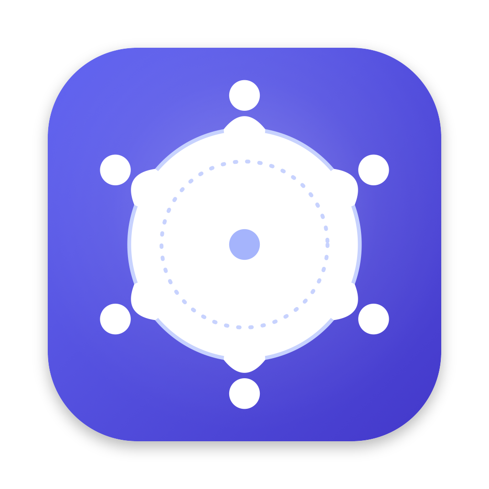

<div align="center">



# Roofle

**The private AI meeting notetaker. No bot, no cloud audio, no subscription.**

Live notes that write themselves, and the right question at the right moment, all from a menu-bar icon nobody else can see.

[](https://github.com/roofle-ai/roofle/releases)
[](https://github.com/roofle-ai/roofle/stargazers)
[](LICENSE)


### ⭐ If Roofle is useful, [star this repo](https://github.com/roofle-ai/roofle). It takes two seconds and it's the only way we get noticed. ⭐

</div>

---

A macOS menu-bar app that listens to your meetings (your
microphone and the system audio), transcribes them **on-device**, and helps you
while they happen:

- **Live transcription** from the mic and system audio, tagged by source.
- **Live notes**: one short, continuously rewritten notes document
  (summary, key points, decisions, action items).
- **Suggested questions**: a gap or vague point worth asking about, with a
  **Source** button that jumps to the exact part of the transcript it came from.
- **One Click follow-ups** generate one click email, slack message, action items.

Speech recognition and storage run locally. Notes, questions and reviews use an
AI provider through an API key you add in Settings.

## ✨ Why Roofle

Most meeting-note tools make you trade your privacy for convenience. Roofle doesn't.

| | **Roofle** | **Granola** | **Otter** | **Fireflies** | **Fathom** |
|---|---|---|---|---|---|
| **Price** | **Free**, forever | Free tier, paid ≈ $14+/user/mo | Free (300 min/mo), Pro ≈ $17/mo | Free tier, Pro ≈ $10-18/mo | Free tier, paid ≈ $16-20/mo |
| **Open source** | **Yes (MIT)** | No | No | No | No |
| **Speech-to-text** | **On-device** | Cloud | Cloud | Cloud | Cloud |
| **Audio leaves your device** | **Never** | Yes | Yes | Yes | Yes |
| **Visible bot in the call** | **Never** | No | Bot by default | Bot by default | Bot by default |
| **Live suggested questions, with jump-to-source** | **Yes** | Not core | Not core | Not core | Not core |
| **Choose your AI provider / bring your own key** | **Yes**, incl. self-hosted | No | No | No | No |
| **Account required** | **No** | Yes | Yes | Yes | Yes |
| **Platforms** | macOS (Apple Silicon) | Mac, Windows, iPhone | Web, mobile, desktop | Web, mobile, desktop | Web, desktop |

**Where the others win, honestly:** they have Windows, mobile and web apps, team workspaces, CRM integrations and shared libraries. Roofle is a Mac-only personal tool. Other platforms coming soon. If you need those, use them. If you want your conversations to stay yours, use Roofle.

*Compared on public pricing and feature pages, October 2026. Prices and plans change often, so check each vendor's own page. Spot an error? [Open an issue](https://github.com/roofle-ai/roofle/issues) and we'll fix it.*

### 🔒 Why privacy matters

Meetings are where the sensitive stuff gets said: salaries, deals, layoffs, health, client details, half-formed ideas. A cloud recorder turns every one of those conversations into a copy that sits on someone else's servers, can be breached, subpoenaed, used for training, or kept long after you've forgotten it. Other people on the call never agreed to that.

With Roofle, **the audio never leaves your Mac.** Only the transcript text goes to the AI provider *you* pick, with *your* key, and Roofle has no server in between. Want zero third parties? Point it at a model you run yourself.

### 🎯 What makes Roofle different

- **Private by design**: on-device speech recognition, no accounts, no analytics.
- **Live, not after the fact**: notes rewrite themselves as the conversation unfolds.
- **Helps you ask better questions**: it flags vague points and gaps, and jumps to the exact line they came from.
- **Invisible to everyone else**: no bot, no banner, just a menu-bar icon.
- **Free and open**: no seats, no minutes, no upsell.

## 🚀 Install

```sh
brew install --cask roofle-ai/roofle/roofle
```

(Homebrew adds the `roofle-ai/roofle` tap automatically.) Update later with
`brew upgrade --cask roofle`.

Or download the DMG from the [releases page](https://github.com/roofle-ai/roofle/releases),
open it and drag Roofle to Applications. Roofle can also check for updates from
Settings.

Requires an Apple Silicon Mac on macOS 13 or newer.

On first use macOS asks for **Microphone** and **Screen & System Audio
Recording** access; both are needed to capture each side of a conversation.

## 🎙️ Using Roofle

Roofle runs from the menu bar and launches hidden (no Dock icon). Nothing is
recorded until you start it.

- **Left-click** the tray icon to open the window.
- **Right-click** for the menu: New conversation (⌘⇧S, asks for the goal first), Stop conversation (⌘⇧T), Quit.
- Closing the window only hides it; Roofle keeps running until you choose Quit.

## 🧑‍💻 Contributing

Want to build from source or hack on Roofle? See the [developer docs](docs/DEVELOPMENT.md).

## 📄 License

[MIT](LICENSE) © 2026 Priyanshu Shekhar. Third-party components keep their own licenses.

---

<div align="center">

### ⭐ Still here? [Star the repo](https://github.com/roofle-ai/roofle). Please. ⭐

Made with ❤️

</div>
