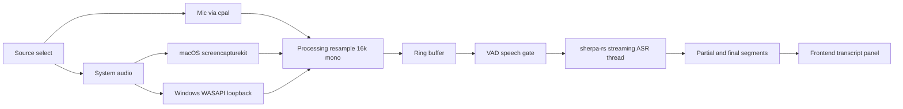

# Roofle -- Cross-Platform Real-Time Audio Transcription App
> Revision 2 — replaces the original whisper-rs + Swift-shim approach. See "Revision history" at the bottom for what changed and why.

## Overview

Build a desktop app (macOS first, Windows later) that:
1. Captures audio from the user's **microphone** and/or **system/device audio output**
2. Runs **real-time streaming transcription** on that audio (on-device, offline)
3. Displays a live-updating transcript in a UI
4. Ships as a shared codebase with platform-specific code isolated to audio capture only

## Tech stack

| Layer | Technology | Reason |
|---|---|---|
| UI shell | Tauri 2 (Rust backend + web frontend) | Small binary, native webview, built-in JS↔Rust IPC |
| Core logic | Rust, split into a pure `core/` library crate | Single codebase, testable, reusable, no UI-shell coupling |
| Mic capture | `cpal` | Cross-platform audio I/O (CoreAudio on macOS, WASAPI on Windows) |
| Transcription | `sherpa-onnx` (official Rust bindings; the earlier `sherpa-rs` crate is deprecated) | **Purpose-built for streaming ASR**, official Rust bindings, built-in VAD, runs on macOS + Windows (x64/arm64); also runs Whisper models if needed |
| macOS system-audio capture | `screencapturekit` crate (pure Rust) | Safe bindings for Apple's ScreenCaptureKit, `captures_audio(true)`, macOS 13+. **No Swift/Obj-C shim required** |
| Windows system-audio capture | WASAPI loopback via `windows-rs` | Native, pure Rust, no shim |
| Resampling / downmix | `rubato` + manual stereo→mono | Normalize capture to 16kHz mono at the pipeline boundary |

## Why these choices (rationale)

- **sherpa-onnx over whisper-rs**: whisper.cpp is batch-oriented; true real-time streaming would require manually reimplementing whisper.cpp's `stream`-style overlapping-window + token-diff trick. The `sherpa-onnx` Rust crate exposes streaming ASR (online Zipformer-Transducer / Paraformer / CTC) as a supported API, with built-in VAD for utterance segmentation. It is a superset — it also runs Whisper models if a Whisper accuracy profile is ever wanted. This makes the hardest milestone (real-time transcription) a supported call rather than hand-rolled logic. *(The `sherpa-rs` crate originally chosen is deprecated upstream in favour of these official `sherpa-onnx` bindings — same engine, so no design impact.)*
- **screencapturekit crate over a Swift/Obj-C FFI shim**: same TCC permission model (Screen Recording), same audio, but pure Rust — no Swift project, no bridging headers, no FFI glue to maintain. Directly serves the "minimal platform-specific code" goal.
- **core/ library + Tauri shell split**: lets the audio→ASR pipeline be validated as a headless CLI before any UI exists (de-risks the hardest part), keeps the pipeline unit-testable, and leaves the option to swap the UI shell later without touching transcription logic.

## 1. Project structure

```
audio-transcriber/
├── core/                         # Pure-Rust library — NO Tauri dependency
│   ├── Cargo.toml
│   └── src/
│       ├── lib.rs
│       ├── audio/
│       │   ├── mod.rs
│       │   ├── mic.rs            # cpal mic capture (cross-platform)
│       │   ├── system_macos.rs   # screencapturekit crate (pure Rust, macOS 13+)
│       │   ├── system_windows.rs # WASAPI loopback via windows-rs
│       │   └── processing.rs     # resample (rubato) + stereo->mono + gain
│       ├── asr/
│       │   ├── mod.rs            # sherpa-rs engine + built-in VAD
│       │   └── segments.rs       # partial/final segment types
│       └── pipeline.rs           # ring buffer -> VAD -> streaming ASR -> events
├── src-tauri/                    # Thin Tauri shell wrapping core/
│   ├── Cargo.toml
│   ├── tauri.conf.json
│   └── src/
│       ├── main.rs               # Tauri entrypoint, registers commands
│       ├── commands.rs           # #[tauri::command]s calling into core/
│       └── state.rs              # shared app state (recording status, transcript buffer)
├── src/                          # Frontend (Svelte recommended; plain HTML/JS ok)
│   ├── index.html
│   ├── main.ts
│   └── styles.css
├── cli/                          # Headless spike binary (reuses core/)
│   └── src/main.rs
├── .github/workflows/ci.yml      # macos-latest + windows-latest matrix
├── package.json
├── Cargo.toml                    # workspace root
└── README.md
```

## Pipeline



## 2. Milestones (build in this order)

### Milestone 0 — Skeleton + CI
- Set up a Cargo **workspace** with `core/` (pure lib, no Tauri) + `src-tauri/` (Tauri shell) + `cli/`.
- Scaffold the Tauri app (`npm create tauri-app@latest`) and confirm it builds/runs on macOS.
- Add a GitHub Actions matrix (**macos-latest + windows-latest**) so Windows-only code compiles continuously from day one — critical because the dev machine is macOS and WASAPI code cannot otherwise be compiled locally.

### Milestone 1 — Headless CLI spike (de-risk streaming ASR)
- `cli/` binary using `core/`: cpal mic capture → resample/downmix to 16kHz mono → sherpa-rs streaming ASR → print partial/final segments to the terminal.
- Purpose: validate latency/accuracy on real audio **before** any UI work, and **pick the default model empirically** (streaming Zipformer-Transducer vs Paraformer vs Whisper; tiny/base/small variants).

### Milestone 2 — Core audio pipeline
- Implement `mic.rs` (cpal: enumerate devices, default, open input stream) and `processing.rs` (rubato resample to 16kHz + stereo→mono downmix + optional gain normalization).
- Stream raw PCM into a ring buffer; expose capture start/stop.

### Milestone 3 — Core transcription
- Implement `asr/` with sherpa-rs streaming engine + built-in VAD on a background thread/task.
- **Never block the audio callback thread** — feed the ring buffer, let the ASR thread pull and infer.
- Emit typed partial/final segment events on a channel.

### Milestone 4 — Tauri shell integration
- Wrap `core/` in `#[tauri::command]`s (start/stop, select source, set model).
- Emit transcript updates to the frontend via Tauri events (`app.emit_all("transcript-update", segment)`).

### Milestone 5 — Frontend UI
- Start/Stop recording button; **source selector (Mic / System / Both)**.
- Live-updating transcript panel (partial + final segments rendered incrementally).
- Audio level meter (RMS of captured buffer); permission status indicator (mic granted/denied).

### Milestone 6 — macOS system audio
- Use the `screencapturekit` crate: `SCStreamConfiguration` with `captures_audio(true)`, 48kHz stereo → downmix/resample into the same pipeline.
- Screen Recording permission UX (separate TCC category from mic; `NSScreenCaptureUsageDescription`). Requires macOS 13+.

### Milestone 7 — Windows system audio
- WASAPI loopback via `windows-rs`: `IMMDeviceEnumerator` → default render endpoint → `IAudioClient` with `AUDCLNT_STREAMFLAGS_LOOPBACK` → `IAudioCaptureClient`.
- Feed into the same shared pipeline. Verified continuously by CI on `windows-latest`.

### Milestone 8 — Polish
- Graceful permission-denied states with in-app instructions.
- Model manager: download on first run with progress events + checksums; tiny/base/small selection with latency/accuracy note.
- Export transcript to `.txt` / `.srt`.
- End-to-end test on both platforms.

## 3. Key implementation notes

- **Never block the real-time audio callback.** `cpal`'s callback runs on a high-priority thread — heavy work (ASR inference, VAD, disk I/O) happens on separate threads/tasks, communicating via a lock-free channel (`crossbeam-channel` or `tokio::sync::mpsc`).
- **Audio format**: ASR engines consume 16kHz mono `f32` PCM. Normalize at the capture boundary: downmix stereo→mono and resample (rubato) regardless of the source's native sample rate (mic typically 44.1/48k; ScreenCaptureKit system audio 48k).
- **VAD is a first-class component**: sherpa-onnx bundles VAD; use it for speech gating and utterance segmentation. Avoid the separate pure-Rust `silero-vad` crate — it is GPL-2.0 licensed (a distribution hazard) and unnecessary here.
- **Mic + system audio mixing / echo**: when both sources are live, system audio played through speakers re-enters the mic. For v1 expose a source selector and merge into **one transcript stream**; recommend headphones for the "Both" case. Echo cancellation is out of scope for this stack.
- **Model size vs latency**: start with the smallest streaming model for lowest latency during development; benchmark on actual target hardware. sherpa-rs also supports Whisper models if a different accuracy profile is needed.
- **Permissions**:
  - macOS mic: `NSMicrophoneUsageDescription` in Info.plist (Tauri bundle settings).
  - macOS system audio: Screen Recording permission (TCC; `NSScreenCaptureUsageDescription`), separate from mic — required even for audio-only capture via `SCStream`.
  - Windows: no equivalent prompt; handle `AccessDenied` errors gracefully.
- **Unsigned app caveat (macOS)**: until code-signed/notarized with a paid Apple Developer account, TCC permission prompts can behave inconsistently across rebuilds — reset with `tccutil reset Microphone` / `tccutil reset ScreenCapture` during development. Document in the README.
- **CI**: run `cargo check`/`cargo test` on both `macos-latest` and `windows-latest`; gate the platform-specific system-audio modules behind `#[cfg(target_os = "...")]` so each platform compiles the right one.

## 4. Dependencies checklist

**Cargo workspace (`Cargo.toml`)**
```toml
[workspace]
members = ["core", "src-tauri", "cli"]
resolver = "2"
```

**core (`core/Cargo.toml`)**
```toml
[dependencies]
cpal = "0.15"
sherpa-onnx = "1.13"              # streaming ASR + VAD (official Rust bindings; sherpa-rs deprecated)
rubato = "0.15"                   # resampling
crossbeam-channel = "0.5"
serde = { version = "1", features = ["derive"] }

[target.'cfg(target_os = "macos")'.dependencies]
screencapturekit = "10"           # pure-Rust ScreenCaptureKit audio capture, macOS 13+

[target.'cfg(target_os = "windows")'.dependencies]
windows = { version = "0.58", features = ["Win32_Media_Audio", "Win32_System_Com"] }
```

> Versions are starting points; lock exact versions during M0/M1. The `sherpa-onnx` version is verified at implementation time (S5 uses 1.13.x, which downloads a prebuilt native library at build time).

**Frontend**: Svelte recommended (lightweight, reactive, pairs well with Tauri events); plain HTML/JS is an acceptable starting point.

**Models**: download sherpa-onnx GGML/ONNX models from the official k2-fsa sherpa-onnx model repository. Document exact URLs and on-disk cache location; download on first run with progress + checksum (do not bundle large models inside the app binary).

## 5. Open decisions (confirm during implementation, do not assume)

- **Default model size** — decide empirically after the M1 CLI spike (streaming Zipformer-Transducer vs Paraformer vs Whisper; tiny/base/small).
- **Distribution plan** — personal use vs distributing to others; affects macOS code-signing/notarization priority and model bundling.
- **Separate tracks vs merged stream** — v1 uses one merged transcript stream; a separate-tracks UI is a future option, not required.
- **Windows test devices** — some virtual audio devices behave differently with WASAPI loopback; document targets.

## Revision history

- **Rev 2.5 (S16)**: Naming consistency — every **user-facing** reference now
  reads **"Roofle"**: Tauri `productName` (`roofle` → `Roofle`), exported
  transcript filenames (`roofle-*` → `Roofle-*`), and model temp files. Internal
  identifiers (crate names `roofle-core`/`roofle-app`, npm `name`, reverse-DNS
  `identifier`, log tags) stay lowercase as required by Cargo/npm conventions.
  Also includes layout + branding polish: the **"Roofle" wordmark moved into
  the left sidebar** (with the meeting glyph), the **main panel header now reads
  "New Transcription"** (a title field is planned for later), and the reserved
  25% right panel is retained. The sidebar **"New transcription" (＋) button was
  removed**; [`main.ts`](src/main.ts) now treats it as optional (`?.`). The
  **logo palette became the app's brand color**: indigo `#6366F1` → violet
  `#4338CA` with light `#A5B4FC`/`#C7D2FE` accents, exposed as CSS
  `--brand*` tokens in [`src/styles.css`](src/styles.css) and applied to the
  wordmark, record button gradient, level meter, progress bar, focus rings, and
  toast.

- **Rev 2.4 (S15)**: Brand icon — **a group of people seated around a round
  table**, Roofle's meeting mark. New vector source
  [`assets/roofle-meeting-icon.svg`](assets/roofle-meeting-icon.svg) (512px,
  indigo gradient rounded-square app-icon) regenerates every bundle icon
  (`src-tauri/icons/*.png`, `icon.icns`, `icon.ico`, Windows Store logos) via
  `qlmanage` + PIL. The macOS menu-bar tray now uses a dedicated 64px monochrome
  template glyph ([`src-tauri/icons/tray.png`](src-tauri/icons/tray.png),
  round table + six seated heads, transparent background) embedded with
  `tauri::include_image!` — the filled rounded-square app icon would have shown
  as a solid block in the menu bar. The frontend gained the same meeting glyph
  as a favicon ([`src/assets/roofle-meeting.svg`](src/assets/roofle-meeting.svg))
  and as a blue icon beside the "Roofle" wordmark.

- **Rev 2.3 (S14)**: Added a macOS **menu-bar mode**. The app launches hidden
  (no Dock icon; `LSUIElement` in Info.plist + `ActivationPolicy::Accessory`),
  shows a tray icon in the menu bar, and recording is strictly on-demand via the
  tray menu's **Start Recording / Stop Recording / Quit Roofle** items.
  Left-clicking the tray icon opens the existing transcript popup window
  (`visible: false` main window shown on demand); closing it hides the window
  (close-to-hide) so the app keeps running in the menu bar — only Quit exits.
  Recording state is shared between the tray menu and the popup UI through a
  `recording-state` event and an `AppState.recording` flag; the shell's
  `start_recording`/`stop_recording` commands publish that state on success, and
  the tray menu's Start honors the last-selected source. Tray actions run on a
  background thread so a first-run model download never freezes the menu thread.

- **Rev 2.2 (S6)**: Default model chosen empirically and locked in: `sherpa-onnx-streaming-zipformer-en-20M-2023-02-17` (streaming Zipformer-Transducer, English, int8 encoder ~43 MB). It is the smallest streaming English model that (a) reproduced the S5 test WAVs near-verbatim, (b) runs comfortably real-time on CPU, and (c) is already the `scripts/fetch-assets.sh` baseline — so the CLI's default `--model-dir` (and the future in-app default) points at it with zero extra download cost. `core::asr` gained a live streaming session (`AsrEngine::stream` → feed 16 kHz mono chunks, poll partials, close utterances on endpoint), driven headlessly by `roofle-cli stream` (S6). Revisit if a latency/accuracy benchmark on target hardware says otherwise (open decision: "Default model size").
- **Rev 2.1 (S5)**: Switched from the deprecated `sherpa-rs` crate to the official `sherpa-onnx` Rust bindings (same sherpa-onnx engine — no design impact). S5 verified `core::asr` offline: loads `sherpa-onnx-streaming-zipformer-en-20M-2023-02-17` (streaming Zipformer-Transducer, English) and transcribes the bundled test WAV `1.wav` correctly. Default model size for S6 is still decided empirically, but this 20M streaming model is the S5/dev baseline (download via `scripts/fetch-assets.sh`).
- **Rev 2 (previous)**: Replaced `whisper-rs` with streaming ASR via sherpa-onnx (true streaming + built-in VAD); replaced the hand-rolled Swift/Obj-C shim with the pure-Rust `screencapturekit` crate; restructured into a `core/` library + Tauri shell + `cli/`; added CI matrix from day one; added VAD as a first-class component; documented the echo consideration for mic + system audio mixing.
- **Rev 1 (original)**: Tauri + cpal + whisper-rs + custom Swift shim + WASAPI loopback.
